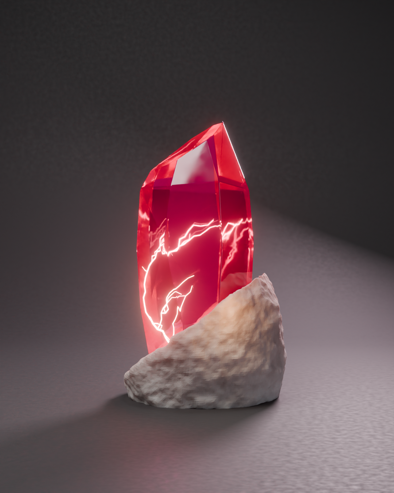
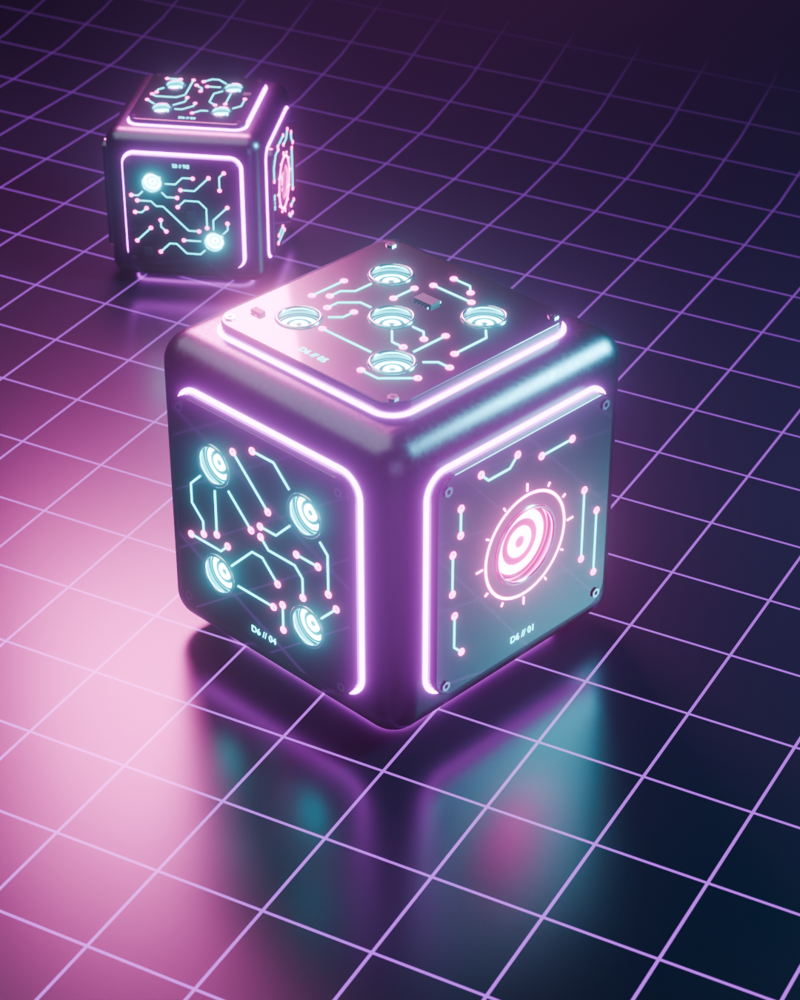
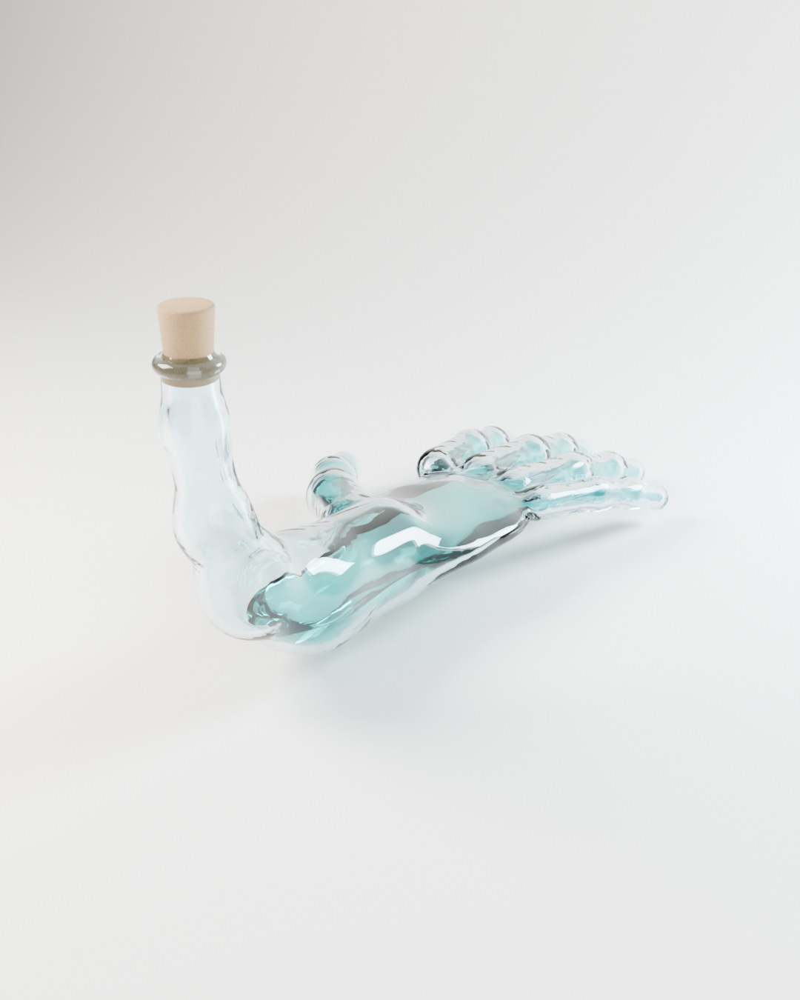

# blender-daily

Blender の Python スクリプトで毎日1つ 3D モデルを作る制作日記です。
各作品フォルダには「再現できる Python コード」と「レンダリング画像」をセットで置いています。

## 作品一覧

<!-- GALLERY:START -->
作品数: 4

<table>
<tr><td align="center" valign="top"><a href="works/2026-11-28_cyber-ribbon"></a><br><sub>2026-11-28</sub><br><a href="works/2026-11-28_cyber-ribbon">サイバティックなりぼん / Cybertic Ribbon</a></td><td align="center" valign="top"><a href="works/2026-11-27_glowing-ruby"></a><br><sub>2026-11-27</sub><br><a href="works/2026-11-27_glowing-ruby">光るルビーの原石 / Glowing Ruby Crystal</a></td><td align="center" valign="top"><a href="works/2026-11-27_cyber-dice"></a><br><sub>2026-11-27</sub><br><a href="works/2026-11-27_cyber-dice">サイバーなサイコロ / Cyber Dice</a></td></tr>
<tr><td align="center" valign="top"><a href="works/2026-11-26_hand-glass-bottle"></a><br><sub>2026-11-26</sub><br><a href="works/2026-11-26_hand-glass-bottle">手のかたちのガラス瓶 / Hand Glass Bottle</a></td></tr>
</table>
<!-- GALLERY:END -->

## フォルダ構成

```
works/
└─ YYYY-MM-DD_作品名/
   ├─ README.md     作品ページ（1行目の「# タイトル」が一覧に載る）
   ├─ xxx.py        再現用スクリプト（これ1つで完結）
   └─ render.png    レンダリング画像（一覧のサムネイル）
scripts/
└─ build_gallery.py  作品一覧を README に書き込むスクリプト
```

## 再現方法

Blender の Scripting タブで各作品の `.py` を開いて「Run Script」。
コマンドラインから画像まで出す場合:

```
blender --background --python works/<作品フォルダ>/<スクリプト>.py -- --render render.png
```

## 毎日の追加手順

1. `works/YYYY-MM-DD_作品名/` を作る
2. スクリプト（`.py`）・画像（`render.png`）・`README.md` を入れる
3. `main` に push すると、GitHub Actions が上の作品一覧を自動で更新する

手元で一覧を確認したいときは `python scripts/build_gallery.py`。

## ライセンス

- コード（`.py` など）: [MIT License](LICENSE)
- 画像（`.png` など）: [CC BY 4.0](LICENSE-IMAGES.md)（クレジット表記で再利用可）
