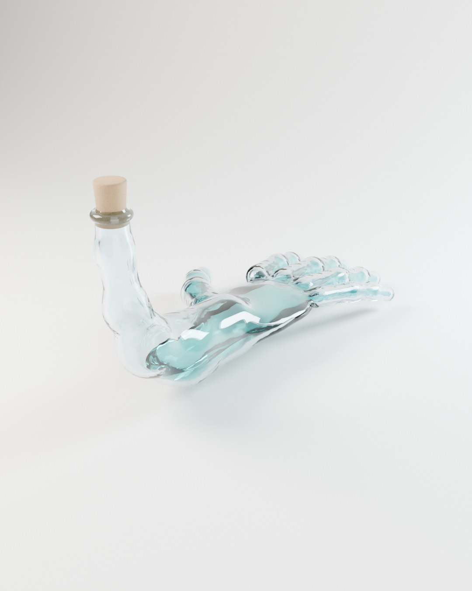

# 手のかたちのガラス瓶 / Hand Glass Bottle



| 項目 | 内容 |
|---|---|
| 日付 | 2026-11-26 |
| Blender | 5.3（4.x でも動作する想定） |
| エンジン | Cycles / 128 samples / 1080×1350 |
| タグ | glass, metaball, liquid, procedural |

## 概要

手のひらを下にして置いた右手を、そのままガラス瓶にした作品。手首が上へカーブして瓶の首になり、コルクで栓をしている。中にはティール色の液体。

- メタボールで手のひら・5本の指・首を一体成形し、メッシュに変換
- Smooth で関節のコブをならし、Solidify でガラスの肉厚をつける
- 同じ形を内側へオフセットし、水位で切って液体にする
- 床（ホリゾント）・3灯ライト・カメラ・レンダー設定まで自動構築

## 再現方法

Blender の Scripting タブで `hand_glass_bottle.py` を開いて「Run Script」。
コマンドラインから画像まで出す場合:

```
blender --background --python hand_glass_bottle.py -- --render render.png
```

## 調整できるパラメータ

| 変数 | 意味 | 既定値 |
|---|---|---|
| `LIQUID_COLOR` | 液体の色 | ティール |
| `FILL_LEVEL` | 液体の水位（Z） | 0.30 |
| `FINGER_SPREAD` | 指の開き具合（倍率） | 1.0 |
| `GLASS_THICKNESS` | ガラスの肉厚 | 0.035 |
| `TURNTABLE` | 120フレームの回転アニメにする | False |

## メモ

- 液体の水位カットはブーリアン（Exact）だと空になったため、bmesh の bisect_plane で切って断面をふさぐ方式にした
- メタボールの見た目の半径は、影響半径の約0.575倍（threshold 0.6 / stiffness 2）
