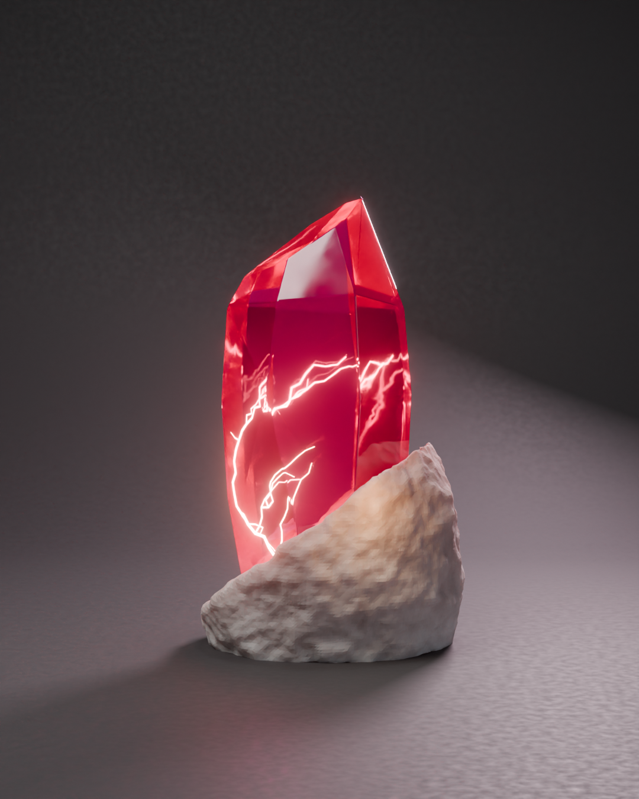

# 光るルビーの原石 / Glowing Ruby Crystal



| 項目 | 内容 |
|---|---|
| 日付 | 2026-11-27 |
| Blender | 5.3（4.x でも動作する想定） |
| エンジン | Cycles / 128 samples / 1080×1350 |
| タグ | crystal, gem, ruby, glass, emission, procedural |

## 概要

内側から金色のひびが光る、ルビー色の原石。根元は白い母岩に埋まっている。

- 六角柱＋錐面の点群を凸包にし、ランダムな平面カットで欠けた面を追加
- ルビーの屈折率（IOR 1.76）のガラス＋ Volume Absorption で、厚いところほど濃い赤に
- 内部のひびは、結晶の内側だけを進むランダムウォークで稲妻状に枝分かれさせた発光カーブ
- 母岩はアイコスフィアを斜めにカット → ボクセルリメッシュ → ディスプレイス2段
- ひびの出口付近の母岩を暖色のポイントライトで照らし、グレーのホリゾントとブルームでまとめた

## 再現方法

Blender の Scripting タブで `glowing_ruby.py` を開いて「Run Script」。
コマンドラインから画像まで出す場合:

```
blender --background --python glowing_ruby.py -- --render render.png
```

## 調整できるパラメータ

| 変数 | 意味 | 既定値 |
|---|---|---|
| `RUBY_COLOR` | 宝石の色 | ルビーピンク |
| `ABSORB_DENSITY` | 奥の色の濃さ（大きいほど赤く深い） | 2.6 |
| `VEIN_COLOR` | ひびの発光色 | 金オレンジ |
| `VEIN_GLOW` | ひびの発光の強さ | 40 |
| `VEIN_BRANCHES` | ひびの枝分かれの数 | 9 |
| `ROCK_COLOR` | 母岩の色 | 白っぽい灰色 |
| `ROCK_HEIGHT` | 母岩の高さ（中央） | 0.72 |
| `ROCK_TILT` | 母岩の上端の傾き（度） | 38 |
| `CRYSTAL_HEIGHT` | 結晶の高さ | 3.0 |
| `CRYSTAL_RADIUS` | 結晶の太さ | 0.56 |
| `SEED` | 形・ひびの乱数シード | 7 |
| `BLOOM` | コンポジットでブルームをかける | True |
| `TURNTABLE` | 120フレームの回転アニメにする | False |

## メモ

- ひびの内外判定は BVHTree の最近点と法線の内積で行い、表面から 0.04 以上内側だけを進ませた（ガラスと面が重ならないように）
- 色は AgX で赤がオレンジ寄りに転ぶので、`RUBY_COLOR` は青を多め（0.95, 0, 0.62）にしてピンクに寄せた。吸収を濃くするほど赤に戻る
- Volume Scatter を強くすると白っぽく濁るので 0.35 に抑えた
- 母岩を照らすポイントライトがガラスに映り込んで光の玉に見えたので、`visible_glossy` / `visible_transmission` も False にした
- 根元の発光球は屈折で大きなボケ玉になったので、半径を小さくした
