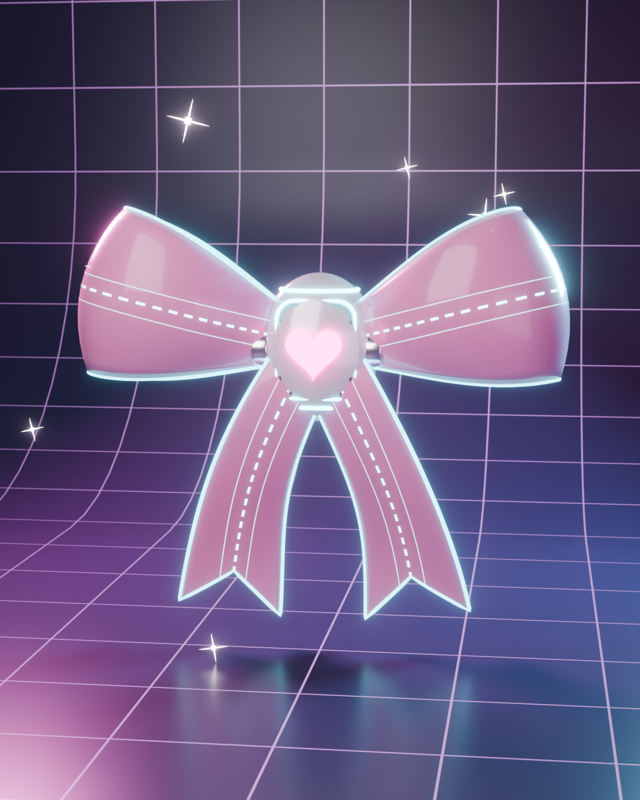

# サイバティックなりぼん / Cybertic Ribbon



| 項目 | 内容 |
|---|---|
| 日付 | 2026-11-28 |
| Blender | 5.3（4.x でも動作する想定） |
| エンジン | Cycles / 128 samples / 1080×1350 |
| タグ | cyber, kawaii, ribbon, neon, emission, procedural |

## 概要

かわいい女の子のイラストの髪飾りにも使えるような、サイバティックなりぼん。パステルピンクの帯にネオンのパイピングを走らせ、結び目をパールホワイトのカプセル型モジュールにした。

- ループとたれは、中心線に沿って帯を掃引して作成（幅・ふくらみ・跳ね上がりをパラメータで制御）
- ループの中心線は結び目でとがるしずく形。結び目でしぼって外側で広がる
- たれは先端をV字カットにし、ゆるく波打たせて少しねじった
- ふちにシアンのパイピング、帯の中央に点線のデータライン、ふち寄りに細いサイドライン
- 地のマテリアルはサテン調（Sheen）＋クリアコート＋薄膜干渉で、ほんのり虹色
- 結び目は黒いガラスの窓にハートのLED。窓のふちと腰に発光リング、両脇に金属のジョイント
- まわりに4方向に光るキラキラ、ラベンダーのホリゾントにネオングリッド

## 再現方法

Blender の Scripting タブで `cyber_ribbon.py` を開いて「Run Script」。
コマンドラインから画像まで出す場合:

```
blender --background --python cyber_ribbon.py -- --render render.png
```

## 調整できるパラメータ

| 変数 | 意味 | 既定値 |
|---|---|---|
| `RIBBON_COLOR` | りぼんの地色 | パステルピンク |
| `EDGE_COLOR` | ふちのパイピングの発光色 | シアン |
| `LINE_COLOR` | 帯の中央の点線の発光色 | シアン |
| `HEART_COLOR` | 結び目のハートLEDの色 | マゼンタピンク |
| `GLOW` | 発光の強さ（全体倍率） | 1.0 |
| `IRIDESCENCE` | 薄膜干渉の膜厚(nm)。0で虹色なし | 260 |
| `LOOP_LENGTH` | ループの長さ | 1.25 |
| `LOOP_WIDTH` | ループ外側の帯の幅 | 0.95 |
| `LOOP_TILT` | ループの跳ね上がり（度） | 14 |
| `LOOP_PUFF` | ループのふくらみ | 0.14 |
| `TAIL_LENGTH` | たれの長さ | 1.55 |
| `TAIL_SPREAD` | たれの開き | 0.55 |
| `KNOT_SCALE` | 結び目の大きさ | 1.35 |
| `SPARKLE_COUNT` | キラキラの数 | 7 |
| `SEED` | キラキラ配置の乱数シード | 28 |
| `BLOOM` | コンポジットでブルームをかける | True |
| `TURNTABLE` | 120フレームの回転アニメにする | False |

## メモ

- 帯はメッシュを直接組み、UV を実寸（u=長さ方向の弧長、v=中心からの距離）にした。点線のピッチやラインの太さが、帯の幅の変化に引っぱられずにそろう
- ふくらみは、帯の法線をループの重心から外向きにそろえ、幅方向に (1-t²) でずらして付けた。前後の帯が外へ張って、布らしい丸みになる
- たれの V字カットは、最後の行だけを切るのではなく、頂点ごとの長さ方向パラメータを「中央ほど短く」スケールして作った。カット付近の面がつぶれない
- bmesh を `to_mesh` したあとは頂点の参照が消えるので、パイピング用の座標は先にコピーしておく
- 地色をそのまま明るいピンクにすると、AgX で白っぽく飛ぶ。彩度を上げた色を置いて、Sheen は控えめにした
- ハートLEDも発光を強くしすぎると白く飛ぶ。強さを下げて、色の彩度で見せた
- グリッドは密だと主張しすぎるので、間隔を広げて細く、暗めにした
